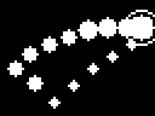
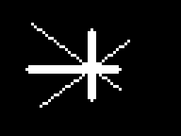
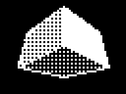
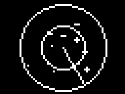

<h1 align="center">Zig MicroView</h1>

<p align="center">
  Four animations for the SparkFun MicroView's 64x48 OLED, written straight for
  the AVR.<br>
  No Arduino code, no floats, no dynamic allocation.
</p>

<p align="center">
  
  
  
</p>

<table align="center">
  <tr>
    <td align="center">
      <br>
      <sub><b>trails</b><br>gravity and a fading wake</sub>
    </td>
    <td align="center">
      <br>
      <sub><b>spokes</b><br>eight pulsing rays</sub>
    </td>
  </tr>
  <tr>
    <td align="center">
      <br>
      <sub><b>cube</b><br>a dither-shaded cube</sub>
    </td>
    <td align="center">
      <br>
      <sub><b>radar</b><br>a sweep with fading echoes</sub>
    </td>
  </tr>
</table>

Each image is a real frame, rendered at 4x on the host by `make screenshots`: it
runs the same `init`/`update`/`render` the firmware does and writes `draw.buf`
out as a PNG.

## Layout

```text
src/
├── draw.zig         384-byte frame buffer; pixel, line, stroke, disc, ring
├── gpio.zig         comptime pins: Pin(.b, 2), drive, pullUp, read
├── microview.zig    SPI, SSD1306 init, display, delay
├── buttons.zig      the two buttons on D2/D3
├── trig.zig         8.8 fixed-point sin/cos
├── main.zig         frame loop and the one-line animation switch
├── screenshots.zig  host-only: renders docs/*.png, never runs on the AVR
└── anims/
    ├── trails.zig   gravity, steering, wall bounce, fading wake
    ├── spokes.zig   pulsing rays, thick axes and thin diagonals
    ├── cube.zig     spinning cube, weak perspective, ordered dither
    └── radar.zig    sweep, LFSR-placed contacts, fading echoes
```

`draw.zig` is hardware-free, so the animations and their tests run on the host.
Only the animation named at the top of `main.zig` is compiled in, so each one's
footprint is the firmware's footprint:

| animation | flash |  RAM |
|-----------|------:|-----:|
| trails    | 2530 B | 480 B |
| spokes    | 2034 B | 386 B |
| cube      | 3362 B | 384 B |
| radar     | 2180 B | 445 B |

RAM includes the 384-byte frame buffer.

## How it works

### Pins

Pins are comptime types, so they cost no RAM:

```zig
const b2 = gpio.Pin(.b, 2); // port B, bit 2
b2.drive(false);            // push-pull output, low
b2.pullUp();                // input with the internal pull-up
_ = b2.read();              // electrical level of the pin
```

<details>
<summary>Where the register addresses come from</summary>

PINx, DDRx and PORTx are three apart from 0x20, so the address is derived from
the port index and checked against the datasheet in a `comptime` block. The
panel is a 3.3 V part on a 5 V board, so its control lines (SS, DC, RST) are
driven high as pulled-up inputs rather than push-pull outputs; that trick is
`pullUp()`.

Pin map and init sequence come from SparkFun's MicroView library: DC = PB0,
SS = PB2, MOSI = PB3, SCK = PB5, 3.3 V regulator enable = PD4, OLED reset =
PD7. The reset/power sequencing and the 32-column display offset match
`MicroView::begin()` and `MicroView::display()`.

</details>

### Animations

- **trails** - a disc falls, bounces off the walls and drags a wake. Physics is
  8.8 fixed point with a speed cap and four substeps per tick; the trail is the
  last positions redrawn as shrinking discs. The buttons tilt gravity, softened
  from the original `MicroViewBounce` sketch into an acceleration.
- **spokes** - eight rays pulse around the centre. The four axes use `stroke`,
  the four diagonals use `line`, so both primitives show in one frame. Buttons
  reverse or double the spin.
- **cube** - a tumbling cube with no trig tables: `trig.sin` is a parabola over
  a 256-step turn, yaw and pitch are absolute angles (so rounding cannot drift),
  and back faces are culled by their rotated normal. The three visible faces are
  scan-filled with 16-level ordered dither. Buttons reverse or speed it up.
- **radar** - a sweep wakes contacts as it crosses them, and each echo shrinks
  over the next revolution. Contacts come from an LFSR, one per sector, so the
  layout is stable but not a flash table. Buttons reverse or speed the sweep.

<details>
<summary>Why the cube's dither no longer blinks</summary>

The 4x4 Bayer matrix is computed from the pixel's low bits rather than stored,
so the build still has zero `lpm` instructions. A face's brightness is the dot
of its normal with a fixed light, mapped to 0..16; increasing it lights one pixel
in sixteen, spread across the face. The older four-bucket shading flipped a whole
face from one pattern to another at a threshold, which read as a flash.

</details>

<details>
<summary>How the radar finds a contact</summary>

The sweep is a `u8` angle. Each frame tests whether the arc it turns through
covers a contact angle, in either direction, so the 255 -> 0 wrap is just two
subtractions. A hit sets that contact's fade to 120 frames; the blip shrinks from
a five-pixel cross to a line to a single pixel as the counter drops. At 40 ms a
frame that is just under one revolution, so old echoes are still faintly visible
when the sweep comes back around.

</details>

## Writing another animation

An animation is any module with four public items:

| Item                                  | Job                           |
|---------------------------------------|-------------------------------|
| `pub const FRAME_MS: u16`             | delay between frames          |
| `pub fn init() void`                  | set the start state           |
| `pub fn update(btn: buttons.State) void` | advance one frame          |
| `pub fn render() void`                | clear `draw.buf` and paint it |

Copy `src/anims/trails.zig`, change the body, and point the `animation` import
at the top of `src/main.zig` at the new file. That is the only switch: an
animation never touches SPI, pins or the panel, only `draw.*`. Add it to the
`shots` table in `src/screenshots.zig` to put it in the gallery, then run
`make screenshots`.

## Build

```sh
make              # build/main.hex, then the host tests
make test         # every module with a `test` block, in one run
make screenshots  # regenerate docs/*.png
make upload       # flash it (PORT=/dev/ttyUSB0 by default)
make clean
```

`make test` greps the sources for `test` blocks, writes a throwaway root in
`src/` that imports each one, and runs `zig test` on it, so a new module is
picked up without editing the Makefile. It prints one line per module plus the
total, and the full per-test output when something fails. The root has to live
in `src/` because Zig keeps imports inside the test root's directory:
`zig test src/anims/trails.zig` alone cannot reach `../draw.zig`.

<details>
<summary>Zig 0.17 on AVR: the three sharp edges</summary>

- Zig builds the object; avr-gcc links it, because Zig's own AVR link places
  `.text` at 0x11000. The link adds crt0 and the vector table.
- `-fno-compiler-rt` is required: compiler_rt does not build for AVR.
- Integer initializers on globals do not always survive into `.data`, so each
  animation's `init()` sets its start state explicitly.

Output is `build/main.hex`, 2 to 3.3 KiB depending on the animation. `make
clean` removes the whole `build/` directory.

</details>

`make upload` runs `avrdude -c arduino -p m328p -P $(PORT) -b 115200`. Override
with `make PORT=/dev/ttyUSB1 upload` or `make AVRDUDE_FLAGS=...`.

> [!NOTE]
> The original firmware that was on the board is backed up outside this repo
> (32 KiB flash + EEPROM readback); restoring it is the same avrdude command
> with that `.hex` file.
